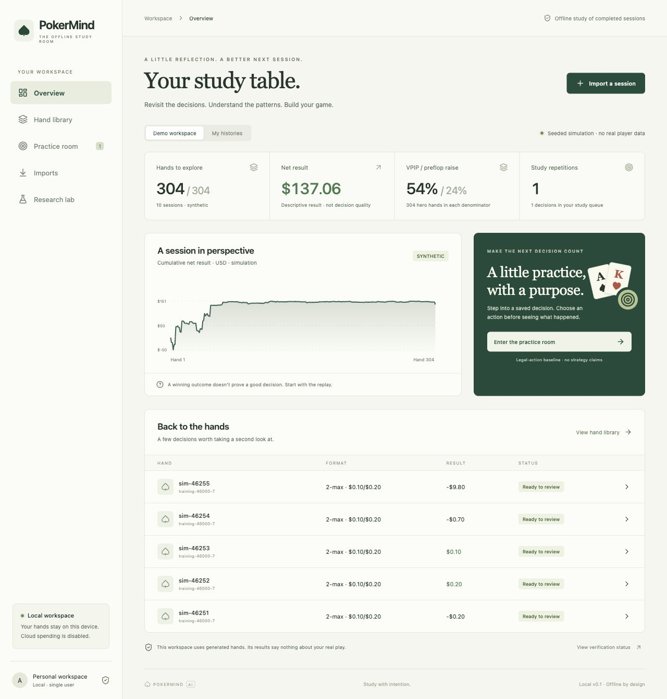

# PokerMind AI

**Deep learning and ML engineering for poker research.** PokerMind connects
PyTorch equity and strategy models to Spark/Delta Lake data pipelines, MLflow
experiment tracking, and a React/FastAPI study application. It includes
Databricks job workflows and AWS deployment tooling validated locally.

**Stack:** Python · PyTorch · Apache Spark · Delta Lake · MLflow · Databricks ·
AWS S3 / DynamoDB / ECR · Terraform · FastAPI · React / TypeScript

The application supports offline study of completed sessions and generated
practice hands. **AWS/Databricks execution and deployment have not been performed;
cloud spending remains disabled. The strategy bot is experimental, not GTO-certified.**

## ML and data engineering highlights

- **Residual deep learning:** three neural networks achieve 0.0326 mean absolute
  error on 1,536 held-out synthetic river states, **22.5% lower than the boosted
  baseline**. This measures heads-up showdown equity, not optimal strategy.
- **Deep reinforcement learning:** Double DQN and neural fictitious self-play
  trained on **18,000 Hold’em hands and 30,000 Kuhn episodes**, then evaluated over
  **14,400 simulated benchmark hands**. Strategy-quality gates failed and are
  reported alongside the results; the model remains an opt-in research opponent.
- **Spark and MLflow:** Bronze/Silver/Gold Delta processing, frozen training
  splits, three-seed experiments, model registration and versioned batch inference;
  the v3 pipeline produced **15,998 predictions locally**.
- **Databricks and AWS preparation:** four-stage Databricks wheel jobs, S3
  snapshot publication, a conditional DynamoDB budget ledger, and Terraform
  templates for private container serving. Local contract, SDK-stub and recovery
  checks are distinct from actual cloud execution.
- **Application validation:** 138 Python tests and 8 desktop/mobile browser tests
  passed in the recorded local research environment. See the
  [verification report](docs/verification.md) for skips, environment differences
  and remaining gates.

Read the [equity results](docs/ml-cloud-progress.md),
[self-play experiment](docs/holdem-selfplay.md), and
[Databricks workflow](databricks/README.md) for implementation and evidence.



## Start here

Prerequisites: Python 3.13 and Node 26.7 (`.nvmrc`). From this directory:

```sh
make setup demo
```

Open [PokerMind](http://127.0.0.1:8000). The demo creates 48 deterministic synthetic
hands, builds the interface and serves only on loopback. No Ignition account,
cloud credentials, Java, GPU or downloaded model is needed. After setup, use
`make demo`. Stop with Ctrl-C. Runtime files stay under ignored `.data/`.

A fresh clone includes source, synthetic fixtures, screenshots and measured
research reports under `benchmarks/results`. Trained weights, personal histories,
local databases and MLflow stores are excluded. The basic demo runs without
research models; train or install the documented artifacts to enable neural play.

1. Explore **Demo workspace**, then open a hand from the library.
2. Use arrow keys, timeline or street buttons. Decision-time view hides other
   players' cards; retrospective reveal is explicitly labeled.
3. Save a decision, enter the practice room, choose a legal action, and inspect
   feedback. Attempts and one/three-day review dates persist in SQLite.
4. **Sessions** groups hands and shows VPIP/PFR/three-bet opportunity counts.
5. **Manage data** downloads originals and previews retention or deletion; see [data controls](docs/data-controls.md).
6. Imports queues manually selected `.txt`/`.jsonl` files, with progress,
   cancellation/retry and paged diagnostics before a separate transactional commit.
7. Replay offers weighted-range equity and bounded action comparisons. Their
   explicit passive continuation, zero rake and sampling uncertainty stay visible.
8. **AI practice coach** compares legal actions in generated river drills using
   three trained networks and an exact reference. Run `make prepare-coach` after
   the v3 research workflow to install the optional models. It also works in
   clearly labeled reference-only mode. See [scope and measured limits](docs/ai-practice-coach.md).
9. **Hold’em practice → NFSP self-play strategy** plays complete simulated hands
   with a newly trained average policy, visible action frequencies and optional
   bot-controlled turns. Three seeds trained on 18,000 Hold’em hands; quality
   gates failed, so this remains opt-in research. See [the self-play report](docs/holdem-selfplay.md).

**Actual Ignition exports are unsupported/unverified.** No sanitized export was
supplied. The implemented input format is PokerMind canonical JSONL, with a sample
in `tests/fixtures/synthetic/sample.jsonl`. Uploads always receive real provenance,
even if their content looks synthetic. Only the internal generator can assign
synthetic provenance. There is no platform connection or live assistance path.

## Research workflow

Install a JDK 17+ (ARM64 on Apple Silicon), then:

```sh
make setup-research
make research-tiny
make evaluate
```

Set `JAVA_HOME` to your JDK installation; a project-local JDK under `.runtime/`
is also discovered when present. See [runtime matrix](docs/runtime.md).
The research install is large and needs internet for packages and first-use Delta
jars. Execution is local and costs no cloud money.

`research-tiny` generates 256 additional heads-up trajectories, reconstructs
observations with Spark, writes Delta Bronze/Silver/Gold/labels, freezes Parquet
splits, trains three CPU seeds, records MLflow runs and batch-scores partitions.
The Research lab shows measured errors. Eligible river reviews show exact reference
equity and a separately labeled **unpromoted** neural estimate. Tiny-data neural
results fail promotion; reference equity remains the product baseline.

Commands also work individually: `make pipeline-local`, `make train-equity`,
`make batch-score`, `make pipeline-incremental` and `make verify-recovery`.
The recovery command uses a fresh isolated synthetic workspace, injects a partial
failure, and compares retry/full/retraction results. Do not run training until the pipeline publishes its manifest.
Local Spark threads are **not** multiple worker machines.

The larger experiments have recorded evidence under `benchmarks/results`.
Their app views require the locally generated runtime artifacts.
Use `make research-local` to reproduce the sequential, bounded suite, or
`make export-local-research` to refresh its checked evidence without retraining.
See [larger local results and run instructions](docs/local-research.md) for the
6,000-hand pipeline, 8,000 behavior trajectories, card-set models, longer Deep
CFR runs, all failed promotion gates, benchmark repetitions and audit correction.

A fresh **16,000-state equity experiment** now passes its declared synthetic
support, accuracy/bias and baseline-improvement gates: residual-network MAE
**3.26 percentage points** versus **4.20** for boosted trees, across three neural
seeds and 1,536 independent test states. The raw-count ablation fails quality.
See [ML and cloud progress](docs/ml-cloud-progress.md) for the protocol, shift
diagnostics, latency, Spark scoring and limitations. Reproduce with
`make research-river`, publish its report with `make export-river-research`, and
add its neural comparisons to eligible sample reviews with `make score-river`.
Exact reference equity remains the default; no production alias is changed.

The [Databricks execution workflow](databricks/README.md) is now implemented with
shared local/cloud Spark transformations, PyTorch/MLflow, versioned scoring, S3
snapshot publication and a conditional DynamoDB budget ledger. Run
`make cloud-preflight`, `make cloud-wheel` and `make verify-cloud-local` locally.
Actual AWS/Databricks execution still requires account-specific validation and
explicit approval of a priced plan. Cloud spending remains disabled.

## Train and play the new opponents

```sh
make setup-research
make research-strategy
make demo
```

`research-strategy` runs Kuhn, Leduc and behavior experiments, including three seeds
and ablations. Use **Small-game trainer** for Kuhn/Leduc or **Hold’em practice** for
full hands against frequency/GRU opponents. After the research commands generate
their runtime artifacts, `make demo` makes both trainers available.

For the NFSP research bot, run the v3 equity workflow followed by
`make prepare-coach` and `make train-holdem-selfplay`; see
[the full prerequisites and results](docs/holdem-selfplay.md).

The server owns chance cards, action legality and saved game state. Refresh resumes
your hand. Models are pinned by digest. Unpromoted neural models are explicit opt-in
research opponents; tabular/frequency baselines remain defaults. See the
[strategy and behavior model card](docs/strategy-model-card.md) for results and limits.

## Checks and useful commands

```sh
make doctor
make test
.venv/bin/python scripts/security_check.py
.venv/bin/python -m services.api.cli import-preview /absolute/path/export.txt
.venv/bin/python -m services.api.cli import-commit FILE_ID
.venv/bin/python -m services.api.cli backup /absolute/path/new-backup-directory
make cloud-plan
```

Restore and verify into a new directory:

```sh
.venv/bin/python -m services.api.cli restore /path/backup /path/new-restored-data
POKERMIND_DATA=/path/new-restored-data .venv/bin/python -m services.api.cli serve
```

Backups include application state, originals and policy/model files needed to resume
games. The rebuildable Spark lake and full MLflow experiment store are excluded.
Never overwrite an active data directory. `make cloud-run` intentionally fails:
authorized spending is $0. The implemented cloud launcher also refuses to submit
work until an exact, priced plan is approved and enabled.

The Research lab also saves and activates local report snapshots. CLI equivalents:

```sh
make release-capture
make release-list
.venv/bin/python -m services.api.cli release-activate RELEASE_ID
.venv/bin/python -m services.api.cli release-check research
```

Activation validates report schemas and all declared artifact checksums, then
switches one pointer. An older valid snapshot restores its report/policy set;
existing games keep their own pinned policies. Failed neural models remain
unpromoted. Backups include release manifests and checked local research summaries.

Fast tests cover engine invariants, evaluator comparison, time gates, import retry,
revisions, hidden-card independence, practice state ownership and backup restore.
Optional research tests also check tiny-batch overfit, gradients, checkpoint
resume, independent strategy references and artifact load parity. Eight automated
desktop/mobile browser checks passed with the locally trained artifacts, covering
imports, research reports, the river coach and NFSP play. Optional model checks
skip when those artifacts are absent. Run `make test-browser` after installing Chromium with
`cd apps/web && PLAYWRIGHT_BROWSERS_PATH=../../.runtime/playwright npx playwright install chromium`.
The [inactive GitHub Actions template](.github/ci.yml.example) defines base,
cloud-contract and browser jobs, none of which provision AWS or Databricks
resources. Actions are initially disabled in the hosted repository to avoid
automatic compute use; remote execution is unverified. To activate CI later,
enable Actions and place the template at `.github/workflows/ci.yml` using a GitHub
login authorized to write workflows.

## Where to look

- [Milestone / verification report](docs/verification.md)
- [Architecture and assumptions](docs/architecture.md), [contracts](docs/contracts.md)
- [Offline policy](docs/offline-policy.md), [parser capabilities](docs/parser-capabilities.md)
- [Threat model](docs/threat-model.md), [runtime matrix](docs/runtime.md)
- [Dataset card](docs/data-card.md), [model card](docs/model-card.md), [evaluation protocol](docs/evaluation-protocol.md)
- [Cloud plan and open approvals](docs/cloud-plan.md), [private deployment candidate](docs/private-deployment-runbook.md)
- [Cloud operations, snapshot installation and benchmark collection](docs/cloud-operations.md)
- [Original master requirements](docs/MASTER_REQUIREMENTS.txt)

Code lives in `apps/web`, `services/api`, `packages`, `pipelines/spark`, `training`
and `evaluation`. Personal histories, model weights, MLflow stores and large shards
stay outside Git. Checked-in research evidence and screenshots use synthetic data.

## Troubleshooting

- **No `.venv` / missing packages:** run `make setup` (research extras are separate).
- **Port 8000 in use:** stop the other PokerMind process or use CLI `serve --port 8001`.
- **Java 11 error:** set `JAVA_HOME` to Java 17+; do not change system Java unnecessarily.
- **Spark cannot bind:** permit local loopback JVM/Python worker sockets. No cloud access needed.
- **Unknown format:** keep the report; provide a small sanitized real export for the parser gate.
- **Quarantined time:** missing/contradictory timestamps need corrected evidence. A completed-session
  declaration only handles a missing end marker and starts a fresh 24-hour delay.
- **Unsupported equity:** the reference currently requires two active players and known actor cards.
- **Model error is high:** this is an honest research result; the model is not promoted.

No tournament ICM, Omaha, multiple boards, straddles, arbitrary-state recommendation,
executed cloud pipeline or private AWS deployment yet. Neural models remain unpromoted.
