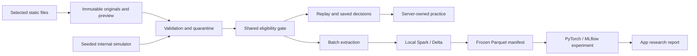

# Architecture and assumption log

One loopback-only FastAPI process serves a built React/TypeScript application.
SQLite owns import state, hands, decision observations, reference results, study
queue and practice attempts. Originals are content-addressed files. Core rules,
observations, metrics and equity have no HTTP dependency. There is no platform
adapter. External files always receive real provenance; only the server generator
creates synthetic provenance.

Requests never start Spark. Local Spark uses two threads on one Mac, not multiple
machines. A published manifest pins independently committed Delta versions and
Parquet checksums. This is not an atomic multi-table Delta transaction. The initial
pipeline merges a full eligible snapshot; incremental extraction now compares a
published source index, reconstructs changed hands and retracts quarantined IDs.
Injected failure/retry and full/incremental equivalence were executed locally.

| Decision | Reason / limit |
|---|---|
| Canonical JSONL first | No real Ignition fixture supplied; no invented compatibility |
| Integer USD cents | Exact accounting; other currencies/scales unsupported in v1 |
| Explicit hero | Never infer from winner or revealed cards |
| Treys + independent reference | MIT evaluator; randomized/edge-case checks, not exhaustive certification |
| CPU reference | Apple Silicon support without requiring MPS/CUDA |
| Optional research dependencies | Replay runs without Java/PyTorch |
| No hosted publication | Local development only; cloud spending remains disabled |
| Research-only neural models | Tiny and larger local runs fail promotion gates |

SQLite now includes normalized actions/outcomes, source-scoped sessions, durable
import jobs, diagnostics, data lifecycle controls and versioned analysis caches.
A filesystem-locked worker processes the bounded queue; cancellation rolls back
commit projections, while restart marks unfinished work for explicit retry.
Imports, diagnostics, hands and sessions have bounded searchable pages.

Historical-ID-only range equity and action comparisons enforce eligibility even
on cache hits. Rollouts resample hidden cards and discard future events/outcomes,
using explicit check/call continuation and zero rake. Unsupported states abstain.
Results disclose model/observation IDs and sampling uncertainty.

Three-seed equity/card-set, behavior and Kuhn/Leduc Deep CFR research is measured
locally. Snapshots validate schemas and artifact hashes, then atomically select a
set of report roles. Saved trainer hands retain their pinned artifacts; activating
a snapshot never promotes a failed neural model. Backups include local evidence
and releases; Spark/MLflow workspaces remain separate.

Open external/quality gates: actual Ignition fixtures, remote CI/runtime validation,
cloud jobs/private deployment and the quality-gated Hold'em neural strategy
extension. Descriptive bb/100 intervals still state the hand-independence
assumption explicitly. See [verification](verification.md) and [local research](local-research.md).
