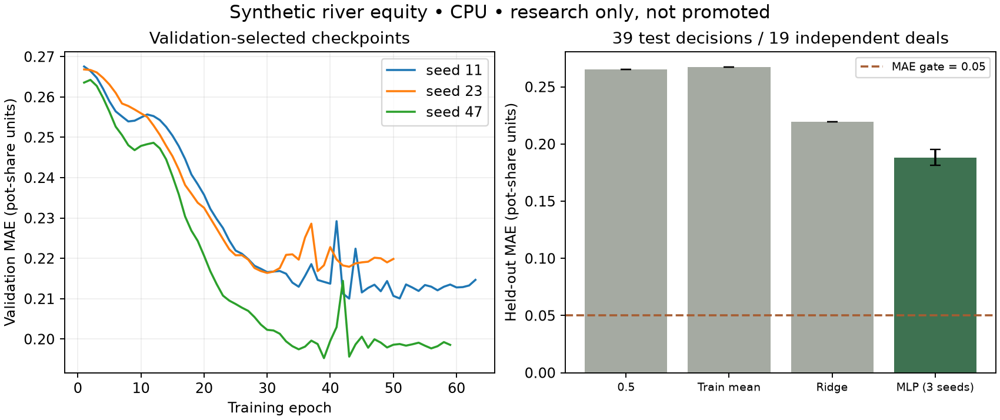

# Equity MLP — research only

Domain: synthetic NLHE river decisions, two active players, actor's two cards,
five-card board, uniform legal random opponent range. Output is showdown pot share,
including ties. No action EV or recommendation.

Architecture: 55 invariant rank/suit features → 64 ReLU → 32 ReLU → sigmoid.
No opponent hidden cards or future outcomes. CPU Adam 0.003, batch 64, max 100
epochs, validation checkpoint, patience 20; seeds 11/23/47. Baselines use training
data only. Labels are exact enumeration. Artifact loads check SHA-256 and use
weights-only deserialization. Parquet streaming bounds training memory.

Test: 39 decisions from 19 independent deals. Neural mean MAE ~0.1882 (std ~0.0069),
ridge ~0.2194, constant-half ~0.2650. These small correlated synthetic samples do
not establish general model quality or real-play improvement. The model fails
both the 0.05 MAE and 500-independent-test-deal gates. **Not promoted.**

Reference equity remains active. Neural predictions are labeled research
comparisons beside reference values, pinned by digest and MLflow run ID. Unsupported
states abstain. No GPU or distributed training claim.

Raw numbers, runs, curves, seeds, calibration bins and artifact paths are in
`benchmarks/results/equity-patched.json` and local MLflow. The initial pre-audit
runtime report is retained separately. The subsequent [larger local research](local-research.md)
executes MLP/card-set/boosted comparisons, data/capacity ablations, rare-state
checks, latency and optional device checks. Larger MLP mean MAE is 0.11823 on
801 test decisions from 358 families, versus boosted 0.11814. Both quality and
support still fail. Broader ranges/streets and real-data generalization remain
outside the model contract. Reference weighted-range analysis is a separate
engine feature; it does not extend the neural model's fixed uniform-range domain.

## Fresh v3 candidate

The independent uniform-river v3 experiment supersedes the earlier conclusion
that every equity model failed. A residual network with visible-card structural
features achieved 0.032568 ± 0.000552 test MAE across three seeds (1,536 independent
test families), versus 0.042021 for boosted trees using the same inputs. Support,
accuracy/bias and baseline-improvement gates passed. Raw-count residual MAE was
0.094150 ± 0.004703 and failed quality. Exact equity remains the serving reference;
the selected network is a labeled historical-review comparison, not a betting
policy. See [ML/cloud progress](ml-cloud-progress.md) for complete provenance,
shift/latency diagnostics, exclusions and reproducible artifacts.

The opt-in [AI practice coach](ai-practice-coach.md) now uses the mean of these
three structural networks in server-generated river drills. A separate rules
calculation converts equity into action values under a uniform always-call
opponent assumption. Exact action values, seed disagreements and sensitivity are
shown beside the estimates. This does not extend the learned equity contract or
promote a general betting strategy; the new ensemble/action diagnostic is
exploratory and has meaningful ranking errors.
