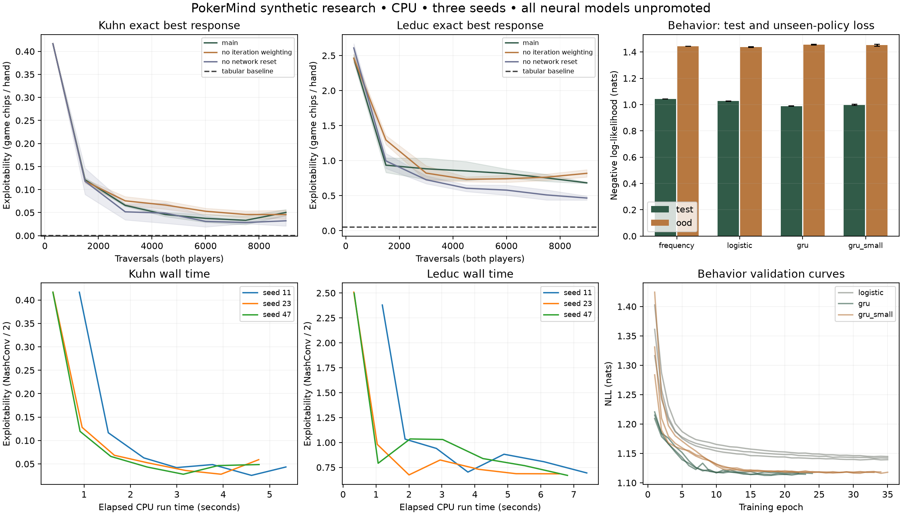

# Small-game strategy and behavior models

These are local research models, with measured failures retained. None is an
approved Hold’em strategy advisor. The product uses tabular CFR for small games
and a training-only frequency model for synthetic Hold’em opponents by default.
The user can explicitly choose an unpromoted neural opponent inside the simulator.

## Executed experiments

```sh
make setup-research
make train-deep-cfr GAME=kuhn
make train-deep-cfr GAME=leduc
make train-behavior
make demo
```

The small-game commands each run three seeds and two ablations (no linear
iteration weights; no advantage-network reset). Behavior runs frequency tables,
three logistic seeds, three 32-unit GRU seeds and three 8-unit GRU seeds. The
logistic model is also the sequence-context exclusion ablation. All are CPU runs.

| Task | Neural result | Retained baseline | Decision |
|---|---:|---:|---|
| Kuhn exploitability | 0.05035 ± 0.00649 | Tabular 0.000938 | Neural fails |
| Leduc exploitability | 0.68309 ± 0.01016 | Tabular 0.05384 | Neural fails |
| Behavior test NLL | GRU 0.98889 | Frequency 1.04366; logistic 1.02657 | Insufficient support |
| Unseen-policy NLL | GRU 1.45554 | Logistic 1.43687 | Generalization remains limited |

Exploitability is **NashConv divided by two**, in each OpenSpiel game's chips per
hand. It is not a Hold’em big-blind rate. NLL uses natural logarithms and measures
next-action prediction, not poker skill. Standard deviations describe three seeds,
not a confidence interval over the population. See the raw reports for each seed,
calibration bins, support counts, model sizes, timings, curves and MLflow run IDs.



## Small-game implementation

OpenSpiel 2.0.2 supplies Kuhn and Leduc rules and information tensors. The project's
own full-tree alternating CFR matches the independent C++ OpenSpiel CFR policy
within floating-point tolerance on both games. Its information-set best response
aggregates hidden histories before selecting an action; it agrees with OpenSpiel's
independent evaluator. Kuhn's limiting expected value is tested against −1/18.
There are 58 tree nodes / 12 information sets in Kuhn and 9,457 / 936 in Leduc.

Deep CFR follows the external-sampling procedure in [Brown et al.](https://proceedings.mlr.press/v97/brown19b.html)
and its [supplement](https://proceedings.mlr.press/v97/brown19b/brown19b-supp.pdf).
Each player has an advantage MLP; a separate network estimates average strategy.
Opponent and chance actions are sampled, while traverser actions are enumerated.
Reservoir sampling retains bounded historical samples; both regression losses
weight samples by iteration. Advantage networks reset each iteration. Nonpositive
regrets select the highest legal regret, with deterministic ties. Initial policies
are uniform. This is a compact implementation for exhaustive small-game evaluation.

The production simulator uses exported probability tables covering **every**
information set, with a pinned digest. A neural export evaluates the trained network
over this finite domain; it is not a tabular model pretending to be neural. Its
training weights, reservoirs and RNG state remain in the checkpoint. Reloading a
checkpoint and continuing matches an uninterrupted deterministic CPU test.
Checkpoints occur only at iteration boundaries, after the temporary optimizer has
completed its reset-and-train cycle. Mid-iteration optimizer recovery is not claimed.

Exact evaluation does not consume the training RNG. Resume a saved strategy
checkpoint with `.venv/bin/python -m training.strategy --game kuhn --resume PATH`.
The tiny protocol has a fixed 30-iteration ceiling; resume continues to that ceiling.
A finished checkpoint is re-evaluated without additional traversal training.

## Behavior data and model contract

The immutable dataset contains 1,192 synthetic hands retained from 1,200 generation
attempts. There are 3,145 train, 875 validation, 401 test and 1,079 unseen-policy
choices. Test support is only **95 hands**, below the predeclared 500-hand gate.
Cautious, pressure and responsive policies generate ordinary splits. A separate
mixed policy is held out for distribution-shift evaluation. None models a real
person. The test set contains no all-in class examples; its aggregate score cannot
establish coverage for that class.

The split key is a suit-canonical initial two-player deal, ignoring player order.
A separate audit found zero family overlap and zero exact encoded-observation
cross-split overlap. Deal families have 1,104 distinct keys. Repeated public
situations within the same partition are allowed. Policy-family generalization is
measured separately; it is not confused with probability calibration.

The 45 state features include acting-player cards, visible board, relative suits,
street and public stacks/bets. Nine-dimensional action tokens encode the public
prefix. Opponent private cards, future actions, outcomes and source IDs are excluded.
Suit-permutation invariance and hidden-card independence are tested. Unknown acting
cards, non-heads-up states and prefixes longer than 64 events are unsupported.
The GRU consumes the actual sequence length, excluding padding. Logistic regression
uses the same state features without the action sequence.

Legal buckets are fold, check, call, half-pot, pot, double-pot and all-in. Bet sizes
use pot-after-call, clamped to server legal raise-to bounds. Duplicate amounts are
collapsed in that order. Labels quantize to the nearest remaining legal amount;
this is a documented lossy action abstraction, not a general no-limit solver.
Illegal categories receive zero probability. The serving simulator maps a sampled
bucket back to its exact legal engine action.

Frequency and logistic fitting use training data only. Early stopping and a small
temperature grid use validation only. Test and unseen-policy results do not select
checkpoints or temperatures. The research opponent is selected by validation NLL.
CPU determinism, tiny-batch overfit, finite gradients, load parity and resume parity
are tested. Shards load at most 128 stored decisions at a time; metric summaries
collect only bounded evaluation predictions. The current tiny corpus is fixed.

Resume behavior training:

```sh
.venv/bin/python -m training.behavior --resume PATH_TO_CHECKPOINT --epochs 35
```

This verifies the frozen dataset, restores optimizer/model/RNG/early-stopping state,
and writes a separate run directory. It does not silently promote the resumed model.

## Boundaries and open research

No six-max strategy claim, anonymous-player identification, range-posterior head,
real/synthetic accuracy comparison, certified Hold’em exploitability or paid
hardware claim is made. The Hold’em opponent is descriptive behavior cloning.
Small-game neural quality is worse than tabular. More data, broader capacity/scale
ablations, calibrated uncertainty under shift, latency/memory benchmarking and a
bounded Hold’em strategy research experiment remain open. No model was promoted
merely because it beat a weak opponent or produced plausible actions.

Independent reference: [OpenSpiel algorithms](https://openspiel.readthedocs.io/en/latest/algorithms.html).
OpenSpiel is Apache-2.0 licensed; it is used as a pinned dependency, not vendored.
The project’s CFR, evaluator and neural training implementations are separate code.

## Larger local follow-up

The October 16 three-seed follow-up generated 8,000 behavior hands and ran
100-iteration, 400-traversal-per-player Kuhn/Leduc experiments with both ablations.
See [the larger local report](local-research.md) for exact metrics and raw artifacts.
The behavior audit found 453 retained test families, correcting the original
585 generated-family count without altering predictions or split membership.
All neural promotion gates still fail. Existing trainer games and the baseline
release remain pinned; larger reports are displayed as separate research evidence.

## Separate Hold’em NFSP experiment

A new opt-in [NFSP self-play opponent](holdem-selfplay.md) now supports complete
50-BB heads-up simulated hands. It uses the frozen river equity ensemble as an
auxiliary input, with separate reinforcement-learning and average-policy networks.
The three-seed run trained on 18,000 Hold’em hands and 30,000 Kuhn control hands.
Both the Kuhn quality gate and the all-opponent Hold’em benchmark gate failed;
general Hold’em exploitability remains uncertified. This exploratory experiment
does not satisfy, replace or weaken the previous Deep CFR promotion requirements.
